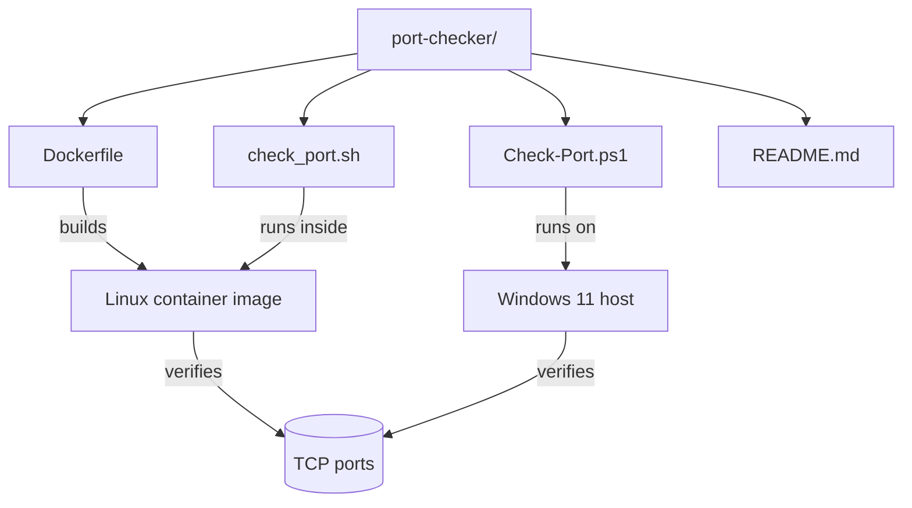
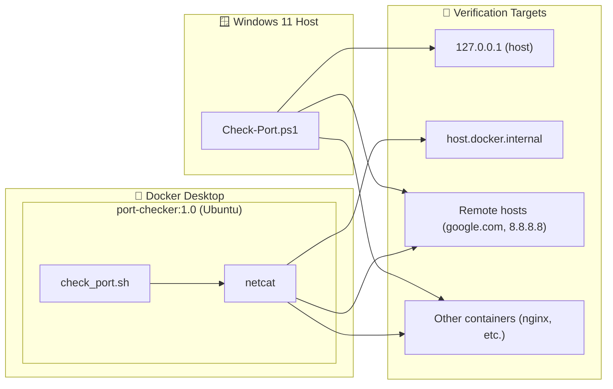
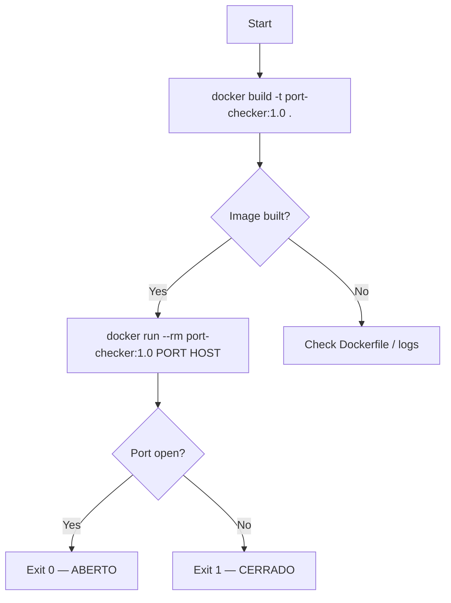
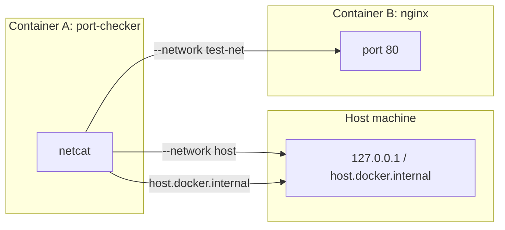
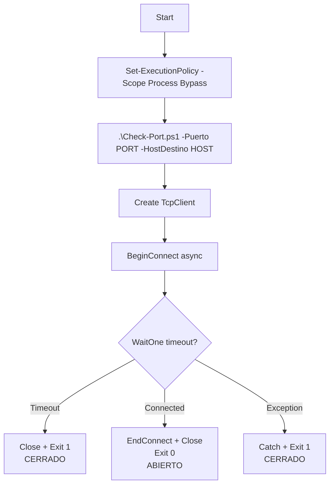
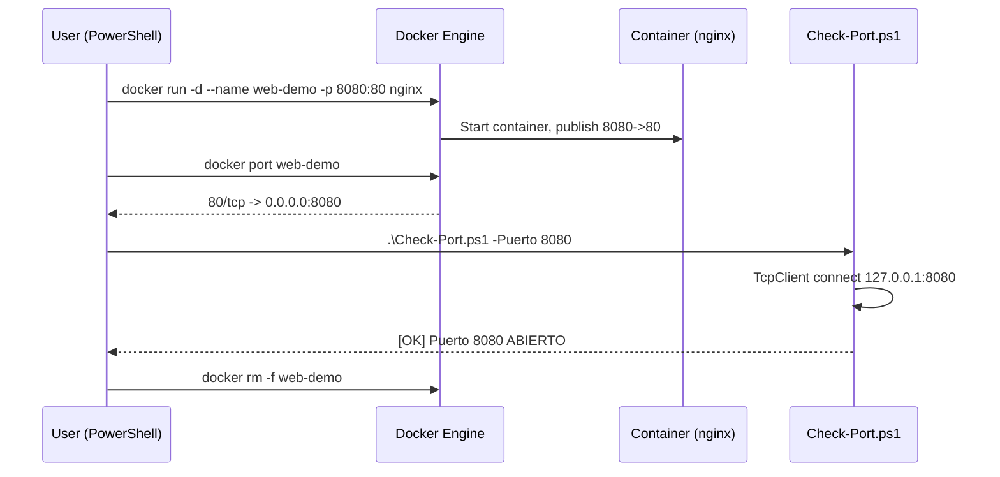
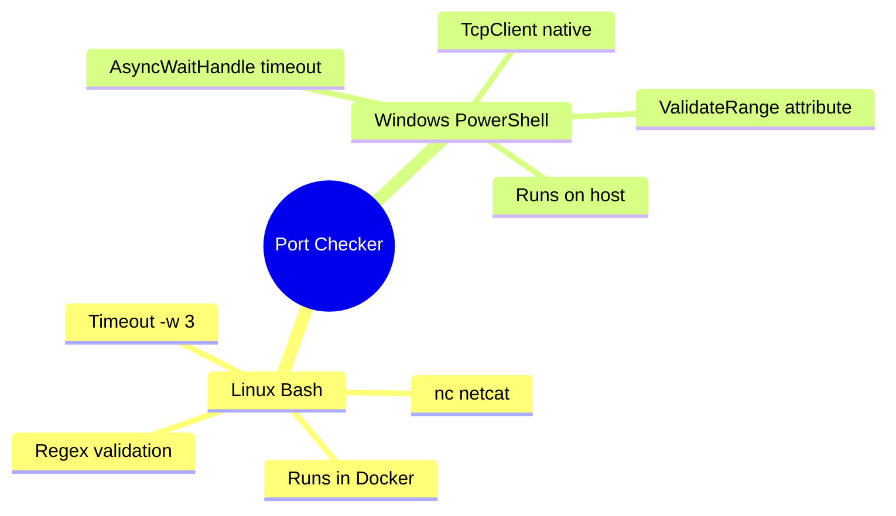
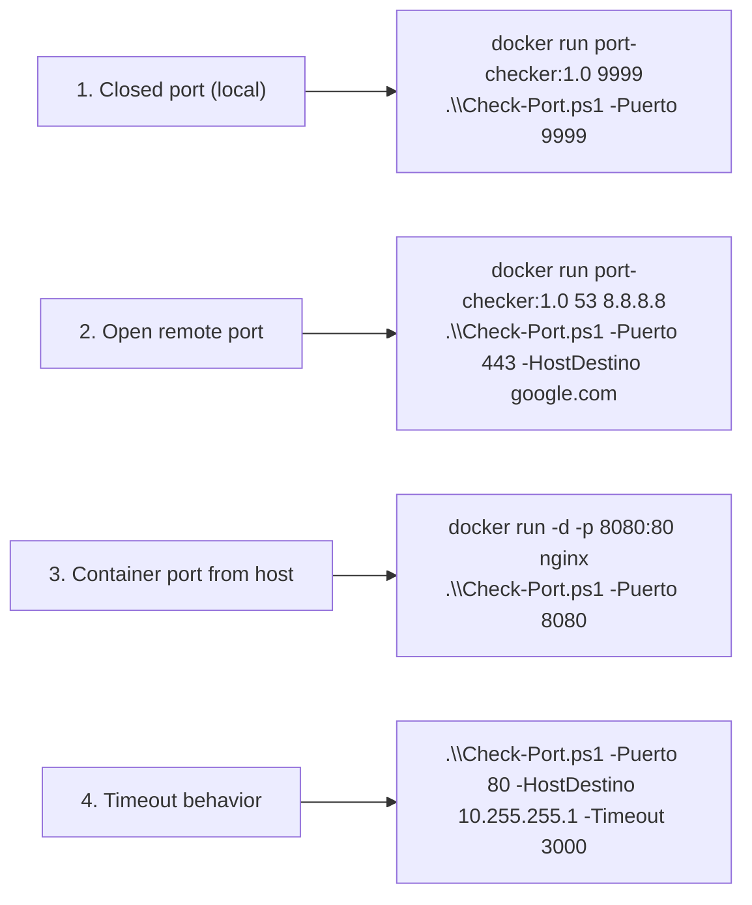

# Port Checker

A cross-platform port checker that determines whether a TCP port is **open** or **closed**. The project includes a **Linux container** (Docker + Ubuntu) running a Bash script, and a **PowerShell script** that runs natively on **Windows 11** (outside Docker).

---

## 📁 Project Structure



---

## 🏗️ Architecture Overview



---

## 🐧 Part 1 — Linux Container (Docker)

### Requirements

- Docker installed (Docker Desktop or Docker Engine).
- No additional dependencies: `netcat` is installed inside the image.

### Workflow



### Build the image

From the `port-checker/` directory:

```bash
docker build -t port-checker:1.0 .
```

Verify the image was created:

```bash
docker images | grep port-checker
```

### Run the container

**Usage:**

```bash
docker run --rm port-checker:1.0 <port> [host]
```

**Examples:**

```bash
docker run --rm port-checker:1.0 9999
docker run --rm port-checker:1.0 53 8.8.8.8
docker run --rm port-checker:1.0 443 google.com
docker run --rm port-checker:1.0
```

**Expected output:**

```
🔍 Verificando puerto 443 en google.com...
✅ El puerto 443 está ABIERTO en google.com
```

**Exit codes:**

| Code | Meaning |
|------|---------|
| `0`  | Port is open |
| `1`  | Port is closed, timeout, or invalid argument |

### Verifying a container from the host



- **Linux/macOS:**
  ```bash
  docker run --rm --network host port-checker:1.0 8000 127.0.0.1
  ```
- **Windows/macOS (Docker Desktop):**
  ```bash
  docker run --rm port-checker:1.0 8000 host.docker.internal
  ```

To verify a port exposed by another container on the same network:

```bash
docker network create test-net
docker run -d --name mi-nginx --network test-net -p 8080:80 nginx
docker run --rm --network test-net port-checker:1.0 80 mi-nginx
```

---

## 🪟 Part 2 — PowerShell Script (Windows 11 host)

This script runs **outside Docker**, directly in PowerShell on your Windows 11 machine.

### Requirements

- Windows 11 with PowerShell 5.1 or PowerShell 7+.
- No external dependencies (uses `System.Net.Sockets.TcpClient`).

### Execution flow



### Allow script execution (once per session)

```powershell
Set-ExecutionPolicy -Scope Process -ExecutionPolicy Bypass
```

> This only affects the current session and reverts when the window is closed.

### Run the script

**Usage:**

```powershell
.\Check-Port.ps1 -Puerto <port> [-HostDestino <host>] [-Timeout <ms>]
```

**Parameters:**

| Parameter      | Type   | Required | Default       | Description                        |
|----------------|--------|----------|---------------|------------------------------------|
| `-Puerto`      | int    | Yes      | —             | Port number (1–65535)              |
| `-HostDestino` | string | No       | `127.0.0.1`   | Host or IP to check                |
| `-Timeout`     | int    | No       | `3000`        | Connection timeout in milliseconds |

**Examples:**

```powershell
.\Check-Port.ps1 -Puerto 9999
.\Check-Port.ps1 -Puerto 3389
.\Check-Port.ps1 -Puerto 443 -HostDestino google.com
.\Check-Port.ps1 -Puerto 3306 -HostDestino 192.168.1.50 -Timeout 5000
.\Check-Port.ps1 443 google.com
```

**Expected output:**

```
[*] Verificando puerto 8080 en 127.0.0.1 (timeout 3000ms)...
[OK] El puerto 8080 esta ABIERTO en 127.0.0.1
```

**Exit codes:**

| Code | Meaning |
|------|---------|
| `0`  | Port is open |
| `1`  | Port is closed, timeout, or connection error |

### Notes

- `$Host` is a **reserved PowerShell variable**. The parameter was renamed to `$HostDestino` to avoid a `VariableNotWritable` error.
- Avoid emojis in `.ps1` files unless saved with the correct encoding (UTF-8).

---

## 🔗 Part 3 — Verifying a Docker Container from PowerShell



### Step 1 — Start a container

```powershell
docker run -d --name web-demo -p 8080:80 nginx
```

### Step 2 — Discover the published port

```powershell
docker port web-demo
```

Example output:

```
80/tcp -> 0.0.0.0:8080
```

### Step 3 — Verify the port from PowerShell

```powershell
.\Check-Port.ps1 -Puerto 8080
```

Native alternative:

```powershell
Get-NetTCPConnection -LocalPort 8080 -State Listen
```

### Step 4 — Clean up

```powershell
docker rm -f web-demo
```

---

## 📊 Comparison



| Feature            | Linux (Bash)              | Windows (PowerShell)                     |
|--------------------|---------------------------|------------------------------------------|
| Tool used          | `nc` (netcat)             | `System.Net.Sockets.TcpClient` (native)  |
| Timeout            | `-w 3`                    | `AsyncWaitHandle.WaitOne(3000)`          |
| Range validation   | Regex + comparison        | `[ValidateRange(1,65535)]`               |
| Arguments          | `$1`, `$2`                | `param()` with attributes                |
| Color output       | ANSI/emoji                | `-ForegroundColor`                       |
| Runs inside Docker | Yes                       | No                                       |

---

## 🧪 Quick Test Scenarios



1. **Closed port (local)**
2. **Open remote port**
3. **Docker container port from host**
4. **Timeout behavior**

---

## 📄 License

Educational project — free to use and modify.